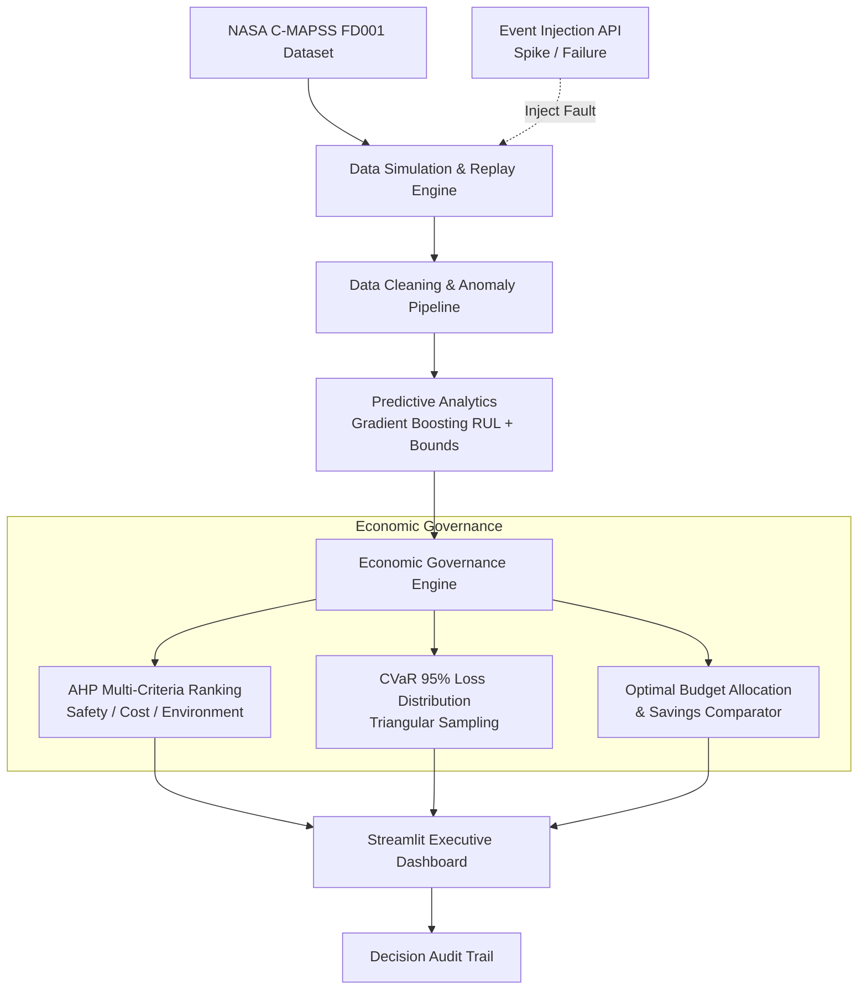

# AEGIS — Asset Economic Governance & Industrial Simulator

[](https://www.python.org/)
[](https://streamlit.io/)
[](https://scikit-learn.org/)
[]()
[]()

> **AEGIS** (*Asset Economic Governance & Industrial Simulator*) is an end-to-end cyber-physical decision support system that bridges high-frequency industrial telemetry with executive financial governance. By coupling **NASA C-MAPSS turbofan degradation modeling** with **machine learning Remaining Useful Life (RUL) estimation**, **Analytic Hierarchy Process (AHP)** multi-criteria ranking, and **Conditional Value at Risk (CVaR 95%)** capital budget optimization, AEGIS enables data-driven, risk-optimized maintenance allocation in real time.

---

## 📌 Table of Contents
- [Executive Overview](#-executive-overview)
- [System Architecture](#-system-architecture)
- [Key Features](#-key-features)
- [Methodology & Theoretical Framework](#-methodology--theoretical-framework)
  - [1. Data Simulation & Telemetry Pipeline](#1-data-simulation--telemetry-pipeline)
  - [2. Predictive Analytics & RUL Estimation](#2-predictive-analytics--rul-estimation)
  - [3. Multi-Criteria AHP Governance](#3-multi-criteria-ahp-governance)
  - [4. CVaR Tail Risk & Budget Optimization](#4-cvar-tail-risk--budget-optimization)
- [Data Schema Contracts](#-data-schema-contracts)
- [Dashboard Walkthrough](#-dashboard-walkthrough)
- [Installation & Getting Started](#-installation--getting-started)
- [Running the Application](#-running-the-application)
- [Test Suite & Verification](#-test-suite--verification)
- [Project Directory Structure](#-project-directory-structure)
- [Course Context & Credits](#-course-context--credits)

---

## 🏛️ Executive Overview

Traditional plant operations suffer from a fundamental disconnect: **engineers monitor sensor degradation, while executives allocate capital based on risk and budgets**. 

When maintenance is purely reactive, catastrophic failures incur crippling downtime penalties. Conversely, heuristic maintenance triggers premature overhauls that drain capital reserves.

**AEGIS solves this problem** by converting physical degradation signals directly into financial risk distributions:
1. **Replays & Ingests** real-world turbofan run-to-failure cycles (NASA C-MAPSS FD001).
2. **Forecasts** Remaining Useful Life (RUL) with calibrated confidence intervals.
3. **Prioritizes** critical assets using the Analytic Hierarchy Process (AHP) weighted across **Safety**, **Cost**, and **Environmental Impact**.
4. **Optimizes** capital allocation from a finite budget pool (₹10,00,000) based on extreme tail risk (**CVaR 95%**), demonstrating substantial monetary savings over reactive baselines.
5. **Enables Real-Time Ripple Testing** via an interactive Event Injection API that dynamically stresses the entire pipeline.

---

## 🏗️ System Architecture



---

## ✨ Key Features

- **Realistic Run-to-Failure Replay**: Built on the benchmark NASA Turbofan Engine Degradation dataset (`train_FD001.txt`), modeling degradation trajectories across 100 engine units.
- **Dynamic Fault & Event Injection**: Runtime injection of unexpected sensor spikes and manual failure shocks with configurable magnitudes, instantly demonstrating downstream governance ripples.
- **Machine Learning RUL Forecasting**: Gradient Boosting Regressor featuring engine-level group cross-validation, RMSE benchmarking, and statistical residual confidence intervals ($\pm 1.96 \sigma$).
- **AHP Multi-Factor Decision Making**: Formal Saaty Analytic Hierarchy Process with mathematical consistency validation ($\text{Consistency Ratio } CR < 0.10$) and rank-flip sensitivity detection.
- **Quantitative Risk Modeling (CVaR)**: Explicit loss distribution sampling capturing downtime rates, component repair costs, and catastrophic replacement expenses.
- **Transparent Audit Trail**: Automatically generated, human-readable explanations detailing why specific assets were flagged, ranked, and budgeted.
- **Executive Streamlit UI**: Dark-themed, interactive dashboard with metric cards, reactive vs. predictive savings charts, and fast-forward cycle advancement.

---

## 🔬 Methodology & Theoretical Framework

### 1. Data Simulation & Telemetry Pipeline
* **Source**: NASA C-MAPSS FD001 dataset comprising 21 sensor channels and 3 operational settings.
* **Feature Selection**: High-sensitivity degradation channels (Sensors 2, 3, 4, 7, 8, 9, 11, 12, 13, 14, 15, 17, 20, 21).
* **Signal Conditioning**: Exponential Moving Average (EMA) smoothing, sliding window anomaly detection, and data quality classification (`ok`, `missing`, `anomaly`).
* **Event Injection**: Simulates transient sensor telemetry shocks or severe structural degradation.

### 2. Predictive Analytics & RUL Estimation
* **Model**: Gradient Boosting Regressor (`n_estimators=100`, `learning_rate=0.05`, `max_depth=4`).
* **Validation**: Split strictly by engine identity to prevent temporal leakage across cycle observations.
* **Uncertainty Quantification**: Residual standard deviation $\sigma_{\text{res}}$ bounds:
  $$\text{Confidence Interval} = \left[\max(0, \widehat{\text{RUL}} - 1.96 \cdot \sigma_{\text{res}}), \; \widehat{\text{RUL}} + 1.96 \cdot \sigma_{\text{res}}\right]$$

### 3. Multi-Criteria AHP Governance
AEGIS applies Saaty's Analytic Hierarchy Process across three strategic criteria:
* **Safety** (weight $\approx 0.637$)
* **Cost** (weight $\approx 0.258$)
* **Environment** (weight $\approx 0.105$)

The pairwise comparison matrix:
$$A = \begin{bmatrix} 1.0 & 3.0 & 5.0 \\ 1/3 & 1.0 & 2.0 \\ 1/5 & 1/2 & 1.0 \end{bmatrix}$$

Validated against the Random Consistency Index ($RI = 0.58$ for $n=3$):
$$CI = \frac{\lambda_{\max} - n}{n - 1}, \quad CR = \frac{CI}{RI} < 0.10 \quad \text{(Strictly Verified)}$$

### 4. CVaR Tail Risk & Budget Optimization
To quantify financial downside beyond simple expected value, AEGIS constructs a **Monte Carlo loss distribution** ($N = 1000$ triangular samples over RUL bounds):
* **Expected Loss**: $\mathbb{E}[L] = \frac{1}{N} \sum_{i=1}^N L_i$
* **Conditional Value at Risk (CVaR 95%)**: Mean loss in the worst 5% tail outcomes:
  $$\text{CVaR}_{0.95}(L) = \mathbb{E}\left[L \mid L \ge \text{VaR}_{0.95}(L)\right]$$
* **Budget Allocation**: Pro-rata risk distribution across a fixed ₹10,00,000 capital pool:
  $$B_i = B_{\text{total}} \times \frac{\text{CVaR}_{95, i}}{\sum_j \text{CVaR}_{95, j}}$$
* **Predictive Savings**: Quantifies monetary benefit compared to full reactive failure (repair + downtime penalties).

---

## 📑 Data Schema Contracts

All inter-module communication is governed by character-aligned JSON/dict schemas (`SCHEMAS.md`):

| Section | Record Type | Key Attributes |
|---|---|---|
| **Section 1** | `Asset Record` | `asset_id`, `cycle`, `sensor_readings`, `health_pct`, `anomaly_detected`, `timestamp` |
| **Section 2** | `RUL Prediction` | `asset_id`, `rul_cycles`, `rul_cycles_confidence_low`, `rul_cycles_confidence_high` |
| **Section 3** | `Ranking Output` | `asset_id`, `priority_rank`, `criticality_score`, `weights_used`, `consistency_ratio` |
| **Section 4** | `Risk/Budget Output`| `cvar_95`, `expected_cost`, `recommended_budget_allocation`, `baseline_reactive_cost`, `predictive_savings` |
| **Section 5** | `Event Injection` | `asset_id`, `event_type` (`sensor_spike` \| `manual_failure`), `magnitude` $\to$ `accepted`, `affected_cycle` |

---

## 🖥️ Dashboard Walkthrough

The web dashboard is organized into four interactive modules:

1. **🏥 Asset Health View**: Live sensor telemetry, health degradation percentages, real-time anomaly status flags, and predicted RUL confidence intervals.
2. **📊 Priority Ranking (AHP)**: Evaluates pairwise criteria weights, verifies Consistency Ratio ($CR$), reports rank sensitivity thresholds, and generates natural-language decision audits.
3. **💰 Risk & Budget Allocation (CVaR)**: Dissects financial exposure (₹), expected loss, recommended capital share from the ₹10L pool, and comparative reactive-vs-predictive savings bar charts.
4. **📋 Scope & Architecture**: Interactive system scope documentation outlining implemented components versus enterprise scaling horizons.
5. **🎛️ Live Control Sidebar**: Fast-forward simulation cycles ($N=1\dots50$) or inject on-demand sensor/failure anomalies.

---

## 📦 Installation & Getting Started

### Prerequisites
* **Python**: 3.10, 3.11, or 3.12
* **Operating System**: Windows, macOS, or Linux

### 1. Clone the Repository
```bash
git clone https://github.com/Tejas-Mahajan/AEGIS-Asset-Economic-Governance-Industrial-Simulator.git
cd AEGIS-Asset-Economic-Governance-Industrial-Simulator
```

### 2. Set Up a Virtual Environment
```bash
# Windows (PowerShell)
python -m venv venv
venv\Scripts\Activate.ps1

# Linux / macOS
python3 -m venv venv
source venv/bin/activate
```

### 3. Install Dependencies
```bash
pip install streamlit pandas numpy scipy scikit-learn
```

---

## 🚀 Running the Application

To start the Streamlit web application:

```bash
streamlit run dashboard/app.py
```

*Or via the Python module runner:*
```bash
python -m streamlit run dashboard/app.py
```

Once running, navigate to:
```
http://localhost:8501
```

---

## 🧪 Test Suite & Verification

AEGIS includes a comprehensive unit and integration test suite covering pipeline streaming, AHP consistency, CVaR loss distributions, and full end-to-end event injection ripples.

Execute all test cases with:

```bash
python -m unittest discover -v
```

**Verification Results:**
```text
Ran 43 tests in 14.507s
OK
```

All 43 unit tests passing:
- `tests/test_full_pipeline.py` (Full ripple validation under event injection)
- `data_simulation/tests/` (Dataset replay, schema mapper, noise/anomaly injection, event API)
- `predictive_analytics/tests/` (Dataset loader, GBR model training, RUL bounds)
- `economic_governance/tests/` (AHP weights, CR calculation, CVaR 95%, budget allocation)
- `dashboard/tests/` (Mock upstream, decision audit trail generation)

---

## 📁 Project Directory Structure

```text
AEGIS/
├── PROJECT_PLAN.md              # Blueprint, module phases & constraints
├── SCHEMAS.md                   # Strict JSON schema specifications
├── README.md                    # Project documentation
├── train_FD001.txt              # NASA C-MAPSS FD001 run-to-failure dataset
│
├── data_simulation/             # Module 1: Replay & Telemetry Simulator
│   ├── dataset.py               # Raw C-MAPSS dataset loader & parsing
│   ├── schema_mapper.py         # Transforms raw telemetry into Asset Records
│   ├── data_pipeline.py         # Noise, missing value & anomaly detection
│   ├── event_api.py             # Event injection API (spikes & manual failure)
│   ├── simulator.py             # Stream simulator engine
│   └── tests/                   # Module 1 unit tests
│
├── predictive_analytics/        # Module 2: Machine Learning & RUL
│   ├── dataset_loader.py        # Group-split dataset preparation
│   ├── model.py                 # GradientBoostingRegressor & confidence bounds
│   ├── model_comparison.py      # Baseline model benchmarking
│   └── tests/                   # Module 2 unit tests
│
├── economic_governance/         # Module 3: Decision Science & Finance
│   ├── ahp.py                   # Analytic Hierarchy Process & Consistency Ratio
│   ├── risk_budget.py           # CVaR 95% loss distribution & budget allocation
│   ├── governance_engine.py     # Unified governance execution engine
│   └── tests/                   # Module 3 unit tests
│
├── dashboard/                   # Module 4: Interactive Web Application
│   ├── app.py                   # Streamlit multi-view application
│   ├── audit_trail.py           # Plain-English decision explanation generator
│   ├── mock_upstream.py         # Standalone mock generators for isolated testing
│   └── tests/                   # Dashboard unit tests
│
└── tests/                       # End-to-End System Integration Tests
    └── test_full_pipeline.py    # Live ripple test verifying all 4 modules
```

---

## 🎓 Course Context & Credits

Developed as part of the **Engineering Economics & Financial Management (EEFM)** curriculum.

* **Author**: Tejas Mahajan
* **Repository**: [AEGIS on GitHub](https://github.com/Tejas-Mahajan/AEGIS-Asset-Economic-Governance-Industrial-Simulator)
* **Dataset Credit**: NASA Prognostics Center of Excellence (PCoE) — C-MAPSS Turbofan Degradation Dataset.
